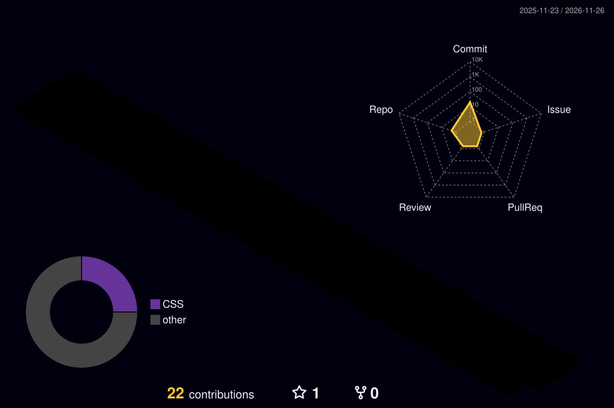

<!-- ═══════════════════════════════════════════════════════════════════════ -->

<!--                         SYSTEM INITIALIZATION                           -->

<!-- ═══════════════════════════════════════════════════════════════════════ -->

<div align="center">


<br>


<br><br>


</div>

---

## `> SYSTEM.INIT()`


## `> ABOUT_ME.exe`
Olá! Eu sou a Beatriz Guerra, estudante de Engenharia da Computação e apaixonada por tecnologia, desenvolvimento de software e
inovação. Minha jornada na programação começou pelo desenvolvimento web, onde descobri o quanto gosto de transformar ideias em
interfaces e soluções funcionais. Atualmente, venho construindo minha base em HTML, CSS e JavaScript, enquanto avanço nos
estudos de React, Java, bancos de dados e desenvolvimento Full Stack. Gosto de aprender colocando a mão na massa: criar projetos,
resolver problemas, experimentar tecnologias e transformar conhecimento em algo que possa ser utilizado de verdade.
Meu objetivo é evoluir constantemente como desenvolvedora e construir soluções que unam tecnologia, criatividade e propósito.

```YAML

name: Beatriz Guerra
education: Computer Engineering

focus:
- Web Development
- Front-end
- Full Stack
- Software Development

currently_learning:
- React
- Java
- APIs
- Databases
- Software Engineering

mindset: "Learn. Build. Improve. Repeat."
```

## > TECH_STACK --scan

### LANGUAGES, FRAMEWORKS & DEVELOPMENT TOOLS

| TECHNOLOGY | STATUS |
|:---|:---:|
| 🌐 HTML5 | 🟢 ACTIVE |
| 🎨 CSS3 | 🟢 ACTIVE |
| ⚡ JavaScript | 🟢 ACTIVE |
| ⚛️ React | 🟡 LEARNING |
| ☕ Java | 🟡 LEARNING |
| 🗄️ SQL / Databases | 🟡 LEARNING |
| 🔧 Git & GitHub | 🟢 ACTIVE |
| 🖥️ VS Code | 🟢 ACTIVE |

---

## `> PROJECTS --open`

### 💻 Personal Portfolio

Portfolio pessoal desenvolvido para apresentar minha trajetória, habilidades e projetos.

**Stack:** HTML | CSS | JavaScript

### 🚀 More Projects Incoming

Novos projetos estão sendo desenvolvidos enquanto amplio meus conhecimentos em desenvolvimento web e Full Stack.

> **STATUS:** BUILDING...
>
> **SYSTEM NOTE:** Mais projetos serão adicionados conforme minha jornada de desenvolvimento evolui.

---

## `> CURRENT_MISSION.sh`

```bash
$ ./current-mission.sh

[■■■■■■■■■■■■■■______] 70%

> Improve JavaScript ............... [OK]
> Master React ..................... [IN PROGRESS]
> Build Full-Stack projects ........ [IN PROGRESS]
> Improve Git & GitHub ............. [OK]
> Learn APIs ....................... [IN PROGRESS]
> Expand database knowledge ........ [IN PROGRESS]
> Build professional experience .... [IN PROGRESS]

MISSION STATUS: RUNNING...

Next objective:
→ Transform knowledge into real-world projects.
```

---

## > GITHUB_STATS --analyze

## `> 🔥 CONTRIBUTION_STREAK`

<p align="center">
  
</p>

## `> 📊 ACTIVITY_GRAPH`

<p align="center">
  
</p>

## `> 🏆 TROPHIES --unlock`

<p align="center">
  
</p>

### 🧊 CONTRIBUTION_MATRIX --3D

<p align="center">
  
</p>

---

## `> 🌐 CONNECT_TO_NETWORK`

<p align="center">
  <a href="https://github.com/BeeaGuerra">
    
  </a>
</p>

<p align="center">
  <i>"THE FUTURE IS BUILT BY THOSE WHO CREATE IT."</i>
  <br/>
  <b>SYSTEM STATUS: ONLINE</b>
</p>


<p align="center">
  
</p>

<!--
**BeeaGuerra/BeeaGuerra** is my special repository
because this README appears on my GitHub profile.
-->
